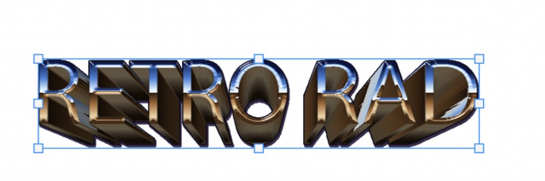

# MS Render

**Retro 3D effects for live text and shapes in Photoshop** – chrome, gold and silver extrusions with
bevels, outlines and hard retro shadows, rendered from your live text so it stays editable.
Part of the MS family with [MS Distress](https://github.com/M0rgenst3rn/ms-distress) and
[MS Printer](https://github.com/M0rgenst3rn/ms-printer).

> **Status: Phase 2.** 14 effects with a clickable thumbnail gallery.



## Effects
| Replaces the look | Behind the layer | On top of the layer |
|---|---|---|
| Chrome Extrude, Inflate, Bevel, Glass | Shadow (long / drop / perspective), Glow, Fire, Smoke, Motion Trail | Electrify, Drip, Icicles, Snow, Water Drops |

Every effect has its own looks (presets). Sizes are in % of the text height, so a look scales with your text.

## What works today
- **Effect gallery**: thumbnails of every effect rendered with *your* selected text – click one and it is
  applied to the canvas. Below it, thumbnails of the looks for the selected effect
- **Live preview** in the panel: Chrome Extrude on the GPU (WebGL 2, 1–5 ms), the other effects on the CPU
  engine at preview size. **Drag in the preview** to move the vanishing point (Chrome Extrude) or set the
  direction (Shadow, Motion Trail)
- **Live text stays live**: the source layer goes into a group *"MS Render · …"* together with the render.
  Change the text and the render updates automatically
- **Settings are stored in the layer** (XMP) – select the group later and the panel restores effect and settings
- **Expands the canvas** when the effect doesn't fit
- **Live mode** (one history step), self-test (57 checks: every effect and look, gallery, drag, live, remove)

## Install (macOS)
```bash
bash install-mac.sh
```
Restart Photoshop → **Plugins › MS Render**.

## Use
1. Select a text or shape layer
2. Click an effect (or a look) in the gallery – it is applied right away
3. Fine-tune in *Settings* or drag in the preview, then **Render** again (or enable **Live**)
4. **Remove** puts the original layer back

## Project layout
```
render/          the plugin
  engine.js      core: distance fields, Chrome Extrude CPU renderer
  effects.js     effect registry: all 14 effects, controls, looks
  preview/       live preview + gallery thumbnails (WebView; fx.js is generated by tools/bundle.js)
  main.js        Photoshop integration (group, XMP, live text, self-test)
tools/           bundle step, Node gallery renderer, icon generator, browser preview harness
```

---

<p align="center"><sub>Built by Linus Leinberger</sub></p>
