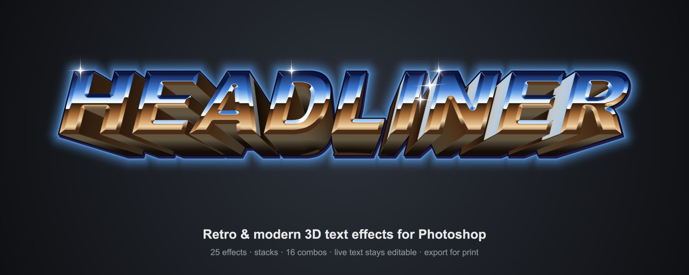
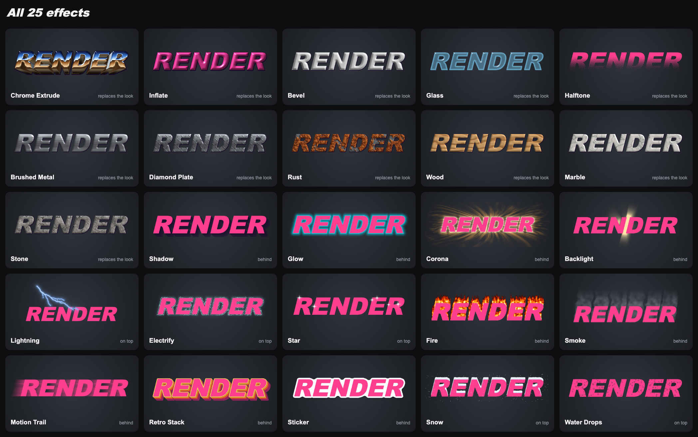
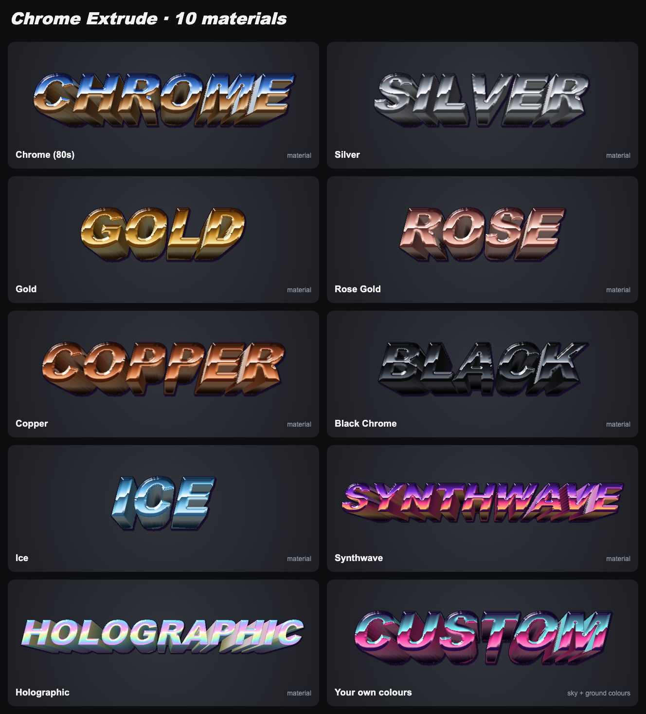
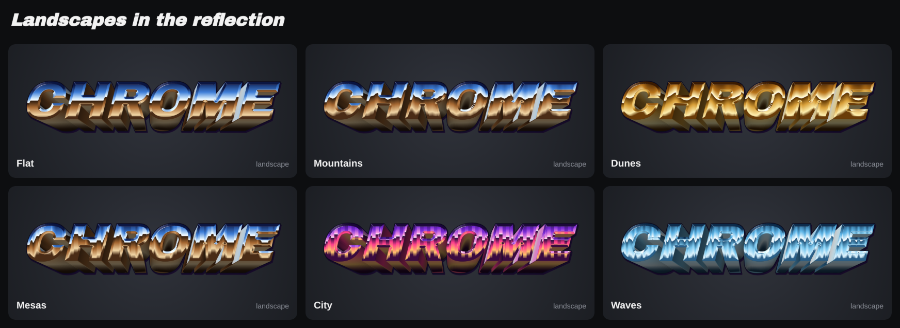
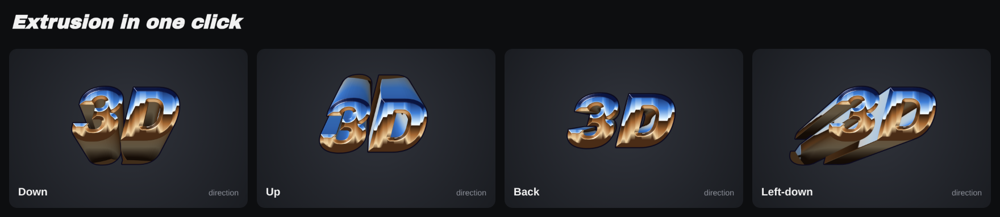
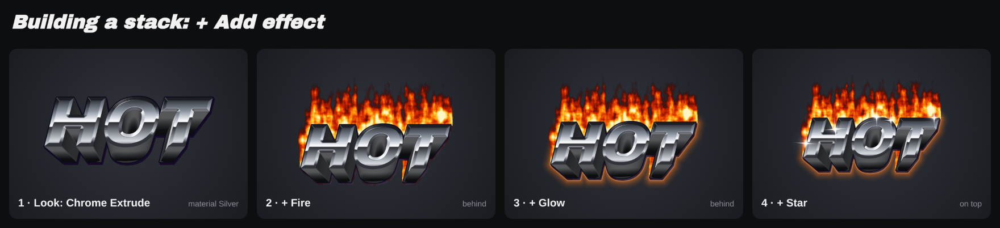
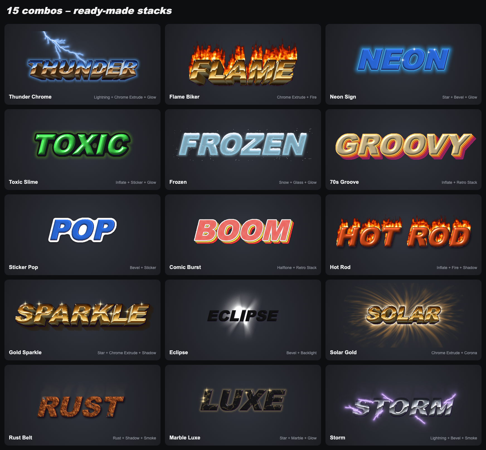
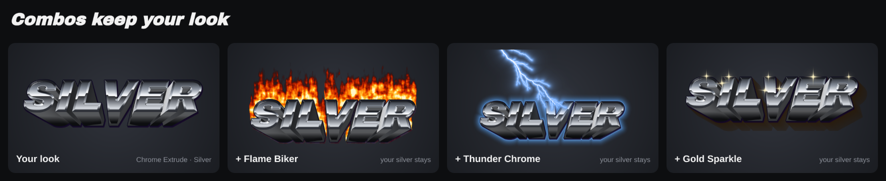
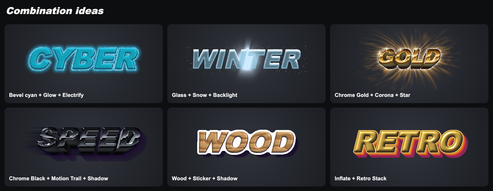

<p align="center">
  
</p>

<p align="center">
  <b>Retro and modern 3D text effects for Photoshop: chrome, gold, fire, lightning, glow and much more.<br>
  Rendered straight from your live text – the text stays editable.</b><br>
  <sub>Photoshop 2023 (24.2) or newer · UXP panel</sub><br>
  <sub>Free tools by <b>Morgenstern</b> · <a href="https://github.com/M0rgenst3rn/ms-distress">Morgenstern Distress</a> · <a href="https://github.com/M0rgenst3rn/ms-printer">Morgenstern Printer</a> · <b>Morgenstern Render</b> · <a href="https://github.com/M0rgenst3rn/ms-phase">Morgenstern Phase</a> · <a href="https://github.com/M0rgenst3rn/ms-glow">Morgenstern Glow</a> · <a href="https://github.com/M0rgenst3rn/ms-gradients">Morgenstern Gradients</a> · <a href="https://github.com/M0rgenst3rn/ms-grids">Morgenstern Grids</a> · <a href="https://github.com/M0rgenst3rn/ms-ascii">Morgenstern ASCII</a></sub>
</p>

---

## What is Morgenstern Render?

Morgenstern Render is a panel plugin for Adobe Photoshop, made for t-shirt designs, logos and titles. Pick a
text or shape layer, click an effect, and you get a finished look – 80s chrome with perspective, fire, neon
glow or lightning. Effects can be **stacked** like layers. **16 combos** give you ready-made combinations.

Everything is computed procedurally, without image files, and stays sharp at any resolution. The result lands
as real layers in a group. Your original layer stays inside it and stays editable: change the text and
Morgenstern Render recomputes the effect automatically.

### Highlights

- **25 effects**: 11 looks, 9 effects behind the text, 5 effects on top of the text
- **Chrome Extrude** in 10 materials with landscapes in the reflection, one-click directions, a movable vanishing point, outlines and hard shadows
- **Stack like layers**: chrome + fire + glow + stars. Every effect becomes its own layer
- **16 combos** as ready-made stacks. **Your look always stays exactly as you set it**
- **Gallery with your own text**: every thumbnail shows your selected lettering
- **Live preview** in the panel, Chrome Extrude on the GPU in a few milliseconds
- **Live text stays live**: change the text and the effect follows
- **A tidy panel**: preview and stack on top, below them tabs for *Effects*, *Combos*, *Settings* and *Export*. Click an effect in the stack and its settings open
- **Export for print**: transparent PNG, 300 dpi, width in cm, hard edges for **DTF**
- **Self-test**: 149 checks against the real Photoshop result

## 25 effects

<p align="center"></p>

| Look (replaces the fill) | Behind the text | On top of the text |
|---|---|---|
| Chrome Extrude, Inflate, Bevel, Glass, Halftone, Brushed Metal, Diamond Plate, Rust, Wood, Marble, Stone | Shadow, Glow, Corona, Backlight, Fire, Smoke, Motion Trail, Retro Stack, Sticker | Lightning, Electrify, Star, Snow, Water Drops |

Every effect has its own **looks** (presets) in the *Settings* tab. All sizes are given in % of the text height, so a look fits any
font size.

## Chrome Extrude

The classic 80s look, in 10 materials – with *Custom colours* you pick the sky and ground of the reflection
yourself:

<p align="center"></p>

**Landscapes in the reflection**: instead of a straight horizon, the chrome can reflect mountains, dunes,
mesas (the classic desert chrome), a city skyline or waves. They repeat seamlessly and scale with your text;
set their height, size and position.

<p align="center"></p>

**Extrusion in one click**: Down, Up, Back, Left-down, Right-down, Left-up, Right-up, Left or Right – or drag
the vanishing point anywhere in the preview.

<p align="center"></p>

More settings:
- **Vanishing point and depth**: drag in the preview or set *Vanish X / Y*
- **Horizon and shine**: where the reflection sits and how strong it is
- **Edges and sides**: chamfered or round bevel, a dark edge line, sides in the material or with a gradient
  (synthwave)
- **Outline and shadow**: a second outline and a hard shadow, each with its own colour and opacity
- **20 looks** to start from, from *80s Chrome* to *Desert Chrome*, *Night City* and *Back in 3D*

## Stacking effects

A stack works like layers in Photoshop. There is one **look** (the fill), plus effects **behind** and
**on top**. Effects behind a look follow its 3D shape: a glow wraps around the extruded letters, not just the
flat text.

<p align="center"></p>

How to build a stack:
1. **Pick a look**, e.g. Chrome Extrude, and set the material to *Silver* in the *Settings* tab
2. Click **+ Add effect**, then **Fire**
3. Click **+ Add effect**, then **Glow**
4. In the stack, change the order with **▲▼**, hide with **●**, remove with **✕**. Click an entry to see its
   settings

### What does each click do?

| Action | Result |
|---|---|
| **Click an effect** | Replaces the effects around your look. **The look stays** |
| **Click another look** (Chrome, Inflate, Bevel …) | Switches the look |
| **+ Add effect**, then an effect or combo | Added to the stack |
| **⌥-click** an effect | Swaps only the selected entry |
| **Click a combo** | Replaces the effects around your look. **The look stays** |
| **✕** on an entry | Removes only that entry |
| **Remove** | Removes every effect, the original layer stands on its own again |
| **⌘Z** | Undoes every step, as usual |

## 16 combos

Ready-made stacks to try. The thumbnails in the panel show every combo **with your text and your look** –
exactly what a click gives you.

<p align="center"></p>

### Your look stays

If you have set a look, e.g. silver chrome with your own depth, every combo keeps it. The combo only swaps
the effects around it. It only brings its own look if you haven't chosen one yet.

<p align="center"></p>

## Combination ideas

Build these stacks yourself with **+ Add effect**:

<p align="center"></p>

| Idea | Look | Behind | On top | Tip |
|---|---|---|---|---|
| Cyber | Bevel, colour cyan, round profile | Glow cyan | Electrify light blue | Dark shirt, glow size 20 % |
| Winter | Glass, light blue | Backlight | Snow | Drag the backlight behind the text |
| Gold | Chrome Extrude, Gold | Corona | Star | A few large stars look classier |
| Speed | Chrome Extrude, Black Chrome | Motion Trail + Shadow | – | Drag the direction in the preview |
| Wood | Wood | Sticker + Shadow (Drop) | – | Classic patch look |
| Retro | Inflate, yellow | Retro Stack | – | Switch the palette in Retro Stack |

## Export for print

In the **Export** tab you save the selected group or all visible layers as PNG:
- **Format**: transparent and trimmed to the design
- **Size**: 300 dpi, you enter the print width in cm
- **Hard edges (DTF)**: removes every semi-transparent pixel. DTF printers would otherwise turn them into halftone fringes
- **Safety**: the export runs on a copy, your document stays untouched

## Installation

### macOS (recommended)

1. Download the repository (**Code → Download ZIP**) and unzip it
2. Run this in Terminal inside the unzipped folder:
   ```bash
   bash install-mac.sh
   ```
3. (Re)start Photoshop → **Plugins › MS Render**

The script needs [Node.js](https://nodejs.org) for the preview's bundle step.

### Alternative: UXP Developer Tool (macOS & Windows)

1. Install "UXP Developer Tools" from the Creative Cloud app
2. In Photoshop, turn on **Developer Mode** under *Settings › Plugins*
3. Run `node tools/bundle.js` once
4. In the UXP Developer Tool choose **Add Plugin**, then `render/manifest.json` → **Load**

## How to use it

1. **Pick a layer**: select a text or shape layer. The gallery immediately shows every effect with your text
2. **Click an effect, look or combo**: the effect is applied right away. A group
   *"MS Render · …"* is created with your layer and one layer per effect
3. **Adjust**: fine-tune in the *Settings* tab or by dragging in the preview, then **Update** (**Apply** on a
   layer without effects yet). A dot on the button means there are changes that aren't applied yet
   - **Live** applies changes right away
   - **Update when the text changes** (in the **⋯** menu) recomputes as soon as you edit the text
4. **More texts**: every text gets its own group. A finished text stays as it is
5. **Edit later**: select the group and the panel loads its stack with all settings
6. **Export**: in the *Export* tab

**Tips:**
- If an effect doesn't fit on the canvas, the switch **Expand canvas when the effect doesn't fit** (at the end
  of the *Settings* tab, on by default) enlarges the canvas. With it off, the effect is cut off at the edge.
- Very large designs (over about 40 megapixels including the room the effect needs) are rendered at a lower
  resolution and scaled back up, so they never fail. The status line then shows the percentage used.

## Project structure

```
render/              The plugin (loaded into Photoshop as is)
  manifest.json      Plugin description
  index.html         Panel UI
  ms-ui.js/.css      Shared Morgenstern controls and design
  styles.css         Panel layout (tabs, stack, gallery)
  icons/             Plugin icons and colour-wheel images
  main.js            Photoshop side (group, XMP, live text, export, self-test)
  engine.js          Core: distance fields, Chrome Extrude renderer
  effects.js         All 25 effects, looks, stacks and combos
  preview/           Live preview and gallery (WebView; fx.js is built by tools/bundle.js)
install-mac.sh       Bundles, packs (.ccx) and installs the plugin
tools/               Bundle step, check scripts, quality bench, showcase renderer, preview test page, browser preview of the panel
docs/images/         Images of this README
docs/quality/        Before/after crops of the render quality work
```

```bash
node tools/qa-check.js              # engine checks without Photoshop (all effects, combos, edge cases)
python3 tools/showcase-server.py    # then open the address it prints: rebuilds the README images

# render quality: anti-aliased text masks, then renders + 4x crops + times (compare against a baseline)
python3 tools/make-masks.py quality-out/masks
node tools/quality-bench.js --out quality-out/after --baseline quality-out/before
node tools/gpu-compare.js           # GPU preview vs. CPU result in headless Chromium (needs Playwright)
```

In the panel, **Self-test** (in the **⋯** menu) checks 149 cases automatically against the real Photoshop
result. It creates its own test document for that.

## Found a bug? Got an idea?

Get in touch! The easiest way is **[Issues](https://github.com/M0rgenst3rn/ms-render/issues)** here on GitHub:
click **New issue** and briefly describe what happened. Your Photoshop version, operating system and a
screenshot help a lot. All you need is a free GitHub account. Suggestions and feature requests are just as
welcome.

## License

[MIT with the Commons Clause](LICENSE): the plugin is free. You may use it for any work, including paid
client work, and you may read, change and share the code.
You may not sell the plugin or a version of it (changed or not), or charge for a product or service whose
value comes mainly from it.
Everything you create with it (designs, images, prints) is yours, and you may sell it.
The license notice stays in copies.

Adobe and Photoshop are trademarks of Adobe Inc. This project is independent and not affiliated with Adobe.

---

<p align="center"><sub>Morgenstern Render<br>
Made by Linus Leinberger</sub></p>
